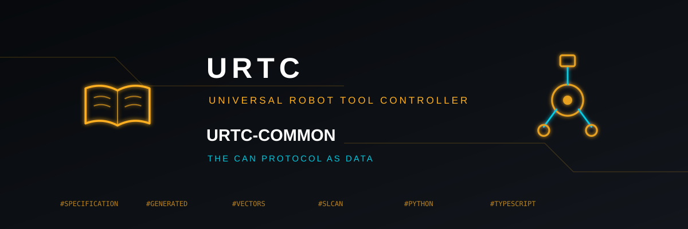

<p align="center">
  
</p>

# 🧩 URTC-COMMON

<p align="center"><a href="README.md">🇺🇸 English</a> | 🇪🇸 <b>Español</b> | <a href="README_fra.md">🇫🇷 Français</a> | <a href="README_ita.md">🇮🇹 Italiano</a> | <a href="README_deu.md">🇩🇪 Deutsch</a> | <a href="README_zho.md">🇨🇳 简体中文</a> | <a href="README_jpn.md">🇯🇵 日本語</a> | <a href="README_por.md">🇵🇹 Português</a></p>

### El protocolo CAN como datos: especificación, códecs generados, vectores de conformidad y transportes compartidos

<p align="center">
  
  
  
  
  
</p>

---

**Comprobación de honestidad - qué funciona hoy de verdad:** este repositorio contiene una especificación, generadores, vectores de prueba y una pequeña biblioteca Python. Todo se ejecuta y se prueba en CI, pero hasta ahora solo lo usan URTC-FLASHER, URTC-TESTER y URTC-WEB-STUDIO (los identificadores, las cargas mágicas, los identificadores de hardware y los vectores compartidos, como copias vigiladas por un archivo de bloqueo); el firmware y los transportes conservan su propia copia del protocolo hasta que cada uno migre. Las pruebas que comparan la especificación con esas copias leen su texto cuando los repositorios están clonados junto a este, y se omiten cuando no lo están. Nada de esto se ha ejecutado contra una placa ni un adaptador CAN: los transportes se prueban con simulaciones, y la especificación indica para cada identificador qué implementaciones lo definen, de modo que las lagunas se ven en lugar de darse por resueltas.

---

> **Estado de seguridad física y de ciberseguridad:** este ecosistema no es un sistema de seguridad certificado y todavía no existe ninguna placa URTC poblada. Los bootloaders comprueban las imágenes de firmware con CRC32 y un HMAC-SHA256 de clave compartida, no con una firma asimétrica (prevista); las imágenes de aplicación publicadas están firmadas con la clave pública de desarrollo (`signing_key_kind: dev`), así que cualquiera puede producir una imagen que el bootloader acepte; no se ha transmitido nada a una placa real. Lee la [línea base de seguridad](https://github.com/JuanenRac/URTC-DOCS/blob/main/docs/SECURITY_BASELINE.md) y el [modelo de amenazas](https://github.com/JuanenRac/URTC-DOCS/blob/main/docs/THREAT_MODEL.md) antes de fiarte de cualquier afirmación de aquí para la seguridad de una persona.

## 📋 De un vistazo

| | |
|---|---|
| Versión | `0.0.7` |
| Madurez | Andamiaje |
| Tests | 431 |
| Tecnología | JSON / Python |
| En hardware real | Solo simulado: probado con emuladores, dobles de prueba o simuladores; no consta ninguna ejecución en hardware real para esta versión |

## 🎯 Descripción general

El protocolo CAN del cabezal de herramienta, escrito una sola vez como datos, y todo lo que se deriva de él:

* [Especificación](spec/can_protocol.json): cada identificador con su dirección, regla de longitud, formato, herramientas y puertas, las cargas mágicas, los registros del esclavo y el subconjunto SLCAN, y qué implementaciones definen cada uno.
* [Contratos](docs/CONTRACTS.md): qué debe hacer una implementación, quién implementa qué hoy, y las lagunas y diferencias conocidas.
* [Formato de la especificación](docs/SPEC_FORMAT.md): las claves del archivo y cómo añadir o cambiar un identificador.
* [Migración](docs/MIGRATION.md): el orden en que cada repositorio puede adoptarlo y cómo una comprobación mantiene iguales las copias.
* [Tabla del protocolo](docs/PROTOCOL_TABLE.md): todos los identificadores en una tabla, generada a partir de la especificación.
* [Varias cabezas de herramienta en un bus](docs/MULTINODE.md): direccionamiento, descubrimiento y reglas de seguridad; implementados en el firmware de URTC tras un interruptor desactivado por defecto, probados solo en el ordenador y no probados en hardware.
* Ayudas de interfaz: `src/urtc_ui`: la lista de idiomas, las insignias de estado y el formato de identificadores, velocidades y tramas que los programas de escritorio pueden compartir (sin Qt; URTC-FLASHER y URTC-TESTER llevan una copia hecha con `vendor_copy.py --set ui`).
* Piezas de firmware: `firmware_base/urtc_crc8.h`, el CRC-8 de las tramas serie del rack y de la visión en un solo sitio (se copia con `vendor_copy.py --set firmware_base`), y `generated/urtc_fw_vectors.h`, los vectores que debe pasar el propio firmware (campos de versión, cargas mágicas, valores de comprobación del CRC-8) como tablas C (`--set fw_vectors`).
* La capa de trama y el limitador de cadencia de los enlaces serie: `firmware_base/urtc_frame.h` (byte inicial, versión, longitud, compleción y CRC-8 de una trama cuyo byte de longitud está en una posición dada, y el camino inverso) y `firmware_base/urtc_rate_limiter.h` (el intervalo mínimo entre mensajes aceptados, a través del desbordamiento del contador de milisegundos), con una referencia en Python (`frame_layer.py`), vectores de cadencia y una prueba en C que somete ambas cabeceras a cada vector de análisis del rack y del sensor de visión (se copian con `vendor_copy.py --set firmware_frame`)
* Un glosario de las expresiones que dicen varios programas: `spec/i18n/glossary.json` nombra cada una una sola vez, en los ocho idiomas, y lista las claves del flasher, el tester, el estudio web y el updater que deben decirla así (Cerrar, Actualizar, Limpiar, PID del calentador, Búsqueda de puertos ...); `tools/i18n_glossary.py` comprueba el fichero, comprueba los programas junto a este repositorio (se perdonan mayúsculas, acentos y puntuación, no una palabra distinta) y reescribe las líneas de los ficheros `.lng` y `.json` que difieren; la comparación nocturna lo ejecuta
* La guía rápida dentro de los programas y las secciones de README que comparten: `help_text.py` (cinco pasos cortos para el flasher y para el tester en los ocho idiomas), `help_qt.py` y `qml/HelpDialog.qml` (la ventana de ayuda; se copian con `--set help` y `--set help_qml`), y `spec/readme/sections.json` con `tools/readme_sections.py` («Cómo se actualiza», «Primer flasheo sin hardware» y «Compatibilidad», escritas una sola vez en los ocho idiomas y colocadas entre comentarios marcadores antes del título de la licencia de los README de los repositorios que las listan; `check` corre en la comparación nocturna)
* La aserción de los tests de host del firmware: `firmware_base/urtc_test.h` contiene `TEST_ASSERT`, la macro que el firmware del rack, de la herramienta de visión y del cabezal definían tres veces; cada repositorio la copia con `vendor_copy.py --set firmware_test` y conserva su propio `test_runner.h` con sus suites.
* [Vectores de conformidad](conformance/can_vectors.json): los bytes que toda implementación debe reproducir: cada formato, los rechazos y los flujos SLCAN.
* [Perfiles de herramienta](spec/tools.json): los 25 perfiles de herramienta (límites, watchdog, pines, placa de expansión) como dato; `generate_tools.py` escribe las tablas de TypeScript y Python y [la tabla de herramientas](docs/TOOLS_TABLE.md). También: el lector de la caja negra con exportación a CSV y JSON (`blackbox.py`), el simulador del rack (`rack_sim.py`), tramas para probar una placa con fuzzing hechas desde la especificación (`fuzz.py`) y la [tabla de compatibilidad](docs/COMPATIBILITY.md) de una release, hecha desde `spec/versions.json`.
* **Placa virtual y enlaces complementarios:** `virtual_board.py` sirve una placa tras un adaptador SLCAN en un puerto TCP (`python -m urtc_common.virtual_board`); escribe `socket://127.0.0.1:7777` donde una herramienta pide un puerto serie y el flasheador, el probador y la pasarela funcionan de extremo a extremo sin hardware. `sensor_frame.py` es la referencia de la trama del sensor de visión; ella y la trama serie del rack son la versión 2, big-endian como el bus, con sus vectores (`conformance/sensor_vectors.json`, `generated/sensor_vectors.h`).
* **Autoactualización desde un paquete firmado:** `self_update.py` es todo el flujo para un programa que se actualiza solo desde una release de GitHub, sin red ni ventana propias (quien lo llama pasa la descarga y el progreso): ofrece solo una versión estrictamente mayor con paquete para la plataforma, descarga solo de los anfitriones de descargas de releases de GitHub, comprueba el tamaño anunciado, el SHA-256 y la firma Ed25519 de `urtc-pkg/1|app|versión|plataforma|sha256|tamaño` con la clave fijada en el programa, extrae sin salir nunca de la carpeta (sin `..`, ruta absoluta, enlace ni dispositivo), se niega a instalar mientras una operación en el bus está en curso, conserva las dos últimas releases, vuelve atrás sola si el primer arranque falla y registra cada paso. Solo biblioteca estándar; se copia con `vendor_copy.py --set update`.
* **El menú «Buscar actualización» de los programas, listo para dibujar:** `update_service.py` contiene las opciones (todas conservadoras: ninguna comprobación si la persona no la pide, `auto_check` apagado, `require_confirmation` encendido, ninguna opción para saltarse la suma de comprobación o la firma ni para añadir un anfitrión; ajustes y variables `URTC_UPDATE_*`, el entorno manda y `lowering_warnings` avisa cuando una ejecución baja una protección), la clave Ed25519 de las releases fijada con su identificador y los pasos `check` / `prepare` / `install` / `rollback`; `update_controller.py` es la máquina de estados que una ventana dibuja (comprobando, disponible, descargando, listo, instalando, instalado, con progreso y error codificado) e instala solo tras `confirm_install`; `launcher.py` arranca la release a la que apunta `current.txt` y vuelve a la anterior si falla un primer arranque; `tools/make_update_package.py` construye el `.zip` / `.tar.gz` reproducible de una release con su `.sha256` y su `.sig` y lo comprueba con la clave fijada. Se copia con `vendor_copy.py --set update`.
* **Herramientas:** `generate_constants.py` escribe la cabecera C, el módulo TypeScript, el módulo Python y la tabla (`--check` compara), `make_conformance.py` escribe los vectores (`--check`), `vendor_copy.py` copia partes a otro repositorio con un archivo de bloqueo y comprueba la copia, y `ci_validate.py` es la comprobación compartida de los repositorios. `make_glance.py` de URTC-DOCS escribe la tabla De un vistazo.

## 🧩 Papel en URTC

URTC-COMMON es el lugar donde el protocolo CAN del cabezal de herramienta se escribe una sola vez, como datos, para que el firmware, URTC-FLASHER, URTC-TESTER y URTC-WEB-STUDIO dejen de mantener cuatro lecturas distintas de la misma prosa. Contiene la especificación, lo que se genera a partir de ella, los vectores que toda implementación debe reproducir y la capa de transporte que comparten las dos herramientas Python. Por sí solo no cambia el comportamiento de ninguna: cada repositorio lo adopta paso a paso (véase docs/MIGRATION.md).

## 📂 Estructura del repositorio

```text
URTC-COMMON/
├── docs/         contratos, formato de la especificación, guía de migración, tabla del protocolo generada
├── spec/         la especificación (can_protocol.json) y su esquema JSON
├── generated/    la cabecera C y el módulo TypeScript, escritos a partir de la especificación
├── firmware_base/ piezas C que comparten los repositorios de firmware (el CRC-8)
├── conformance/  los vectores compartidos
├── src/          el paquete Python: protocolo generado, tramas, códec SLCAN, transportes, versiones, ejecutor de vectores
├── tools/        generadores con --check, vendor_copy.py y las comprobaciones de CI compartidas del ecosistema
├── tests/        pruebas unitarias, la comparación con los repositorios junto a este y la ejecución de los vectores en TypeScript
├── images/       el banner
├── build.sh / build.bat, build-test.sh / build-test.bat, run.sh / run.bat
└── urtc.project.json, pyproject.toml, CHANGELOG.md, LICENSE
```

## 🛠️ COMPILACIÓN Y EJECUCIÓN

**Requisitos:** Python 3.10 o superior; pytest y jsonschema para las pruebas; Node 22.18 o superior para ejecutar el TypeScript generado contra los vectores (opcional)

```bash
python tools/generate_constants.py --check           # los archivos C, TypeScript y Python y la tabla están al día
python tools/make_conformance.py --check             # los vectores están al día
python -m urtc_common.cli conformance                # este paquete reproduce todos los vectores
python tools/vendor_copy.py check TARGET --source .  # una copia en otro repositorio no se ha editado a mano ni se ha quedado atrás
python -m pytest tests -q                            # las pruebas unitarias y la comparación con los repositorios junto a este
```

`build.sh` / `build.bat` suben la versión un paso (el cuentakilómetros del ecosistema), instalan el paquete y ejecutan las pruebas; `build-test.sh` / `build-test.bat` comprueban sin cambiar ninguna versión; `run.sh` / `run.bat` inician la línea de comandos (`conformance`, `describe`, `decode`, `slcan`).

## 🔗 Proyectos relacionados

URTC se compone de repositorios independientes, cada uno con su versión, sus pruebas y su README. Esta es la familia, por grupos:

* **URTC Tool Platform:** [URTC](https://github.com/JuanenRac/URTC), **URTC-COMMON** (este repositorio), [URTC-FLASHER](https://github.com/JuanenRac/URTC-FLASHER), [URTC-GATEWAY](https://github.com/JuanenRac/URTC-GATEWAY), [URTC-SMART-RACK](https://github.com/JuanenRac/URTC-SMART-RACK), [URTC-TESTER](https://github.com/JuanenRac/URTC-TESTER), [URTC-VISION-TOOL](https://github.com/JuanenRac/URTC-VISION-TOOL), [URTC-WEB-STUDIO](https://github.com/JuanenRac/URTC-WEB-STUDIO)
* **Ecosystem Operations:** [URTC-DOCS](https://github.com/JuanenRac/URTC-DOCS), [URTC-UPDATER](https://github.com/JuanenRac/URTC-UPDATER)

**Más allá de URTC:**

* **[HYDRA-UMC](https://github.com/JuanenRac/HYDRA-UMC)** - la placa base del brazo robótico, cuyo relé CAN está documentado como el bus en el que se conecta la cabeza de herramienta
* **[HYDRA-UMC-DOCS](https://github.com/JuanenRac/HYDRA-UMC-DOCS)** - la misma idea para el ecosistema HYDRA-UMC
* **[ARMOR-DOCS](https://github.com/JuanenRac/ARMOR-DOCS)** - la misma idea para el ecosistema de seguridad A.R.M.O.R.
* **[JuanenRac](https://github.com/JuanenRac/JuanenRac)** - el perfil y el panel de estado de todos los ecosistemas

## 📚 Documentación y comunidad

Dónde leer más:

* [Contratos: qué debe hacer cada implementación y las lagunas conocidas](docs/CONTRACTS.md)
* [Formato de la especificación y cómo cambiarla](docs/SPEC_FORMAT.md)
* [Migración: cómo la adopta cada repositorio](docs/MIGRATION.md)
* [Tabla del protocolo: cada identificador y quién lo implementa](docs/PROTOCOL_TABLE.md)
* [Varias cabezas de herramienta en un bus](docs/MULTINODE.md)
* [Registro de cambios de este repositorio](CHANGELOG.md)
* [Licencia (GPL-3.0-or-later)](LICENSE)
* Preguntas, ideas e informes: electrohobby3d@gmail.com

## 👤 AUTOR

**JuanenRac (Electro Hobby 3D)** · electrohobby3d@gmail.com

## 📜 LICENCIA

GPL-3.0-or-later - véase [LICENSE](LICENSE).
