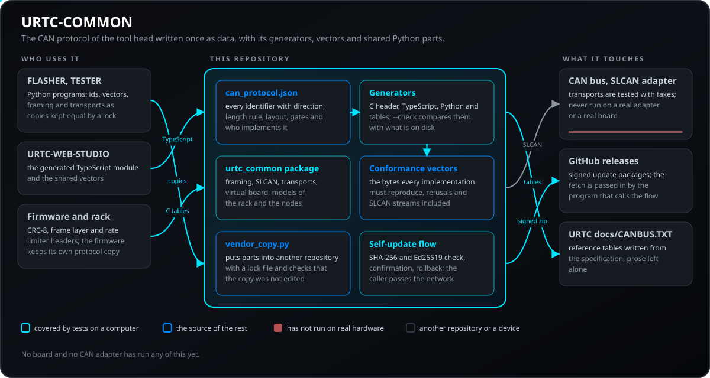
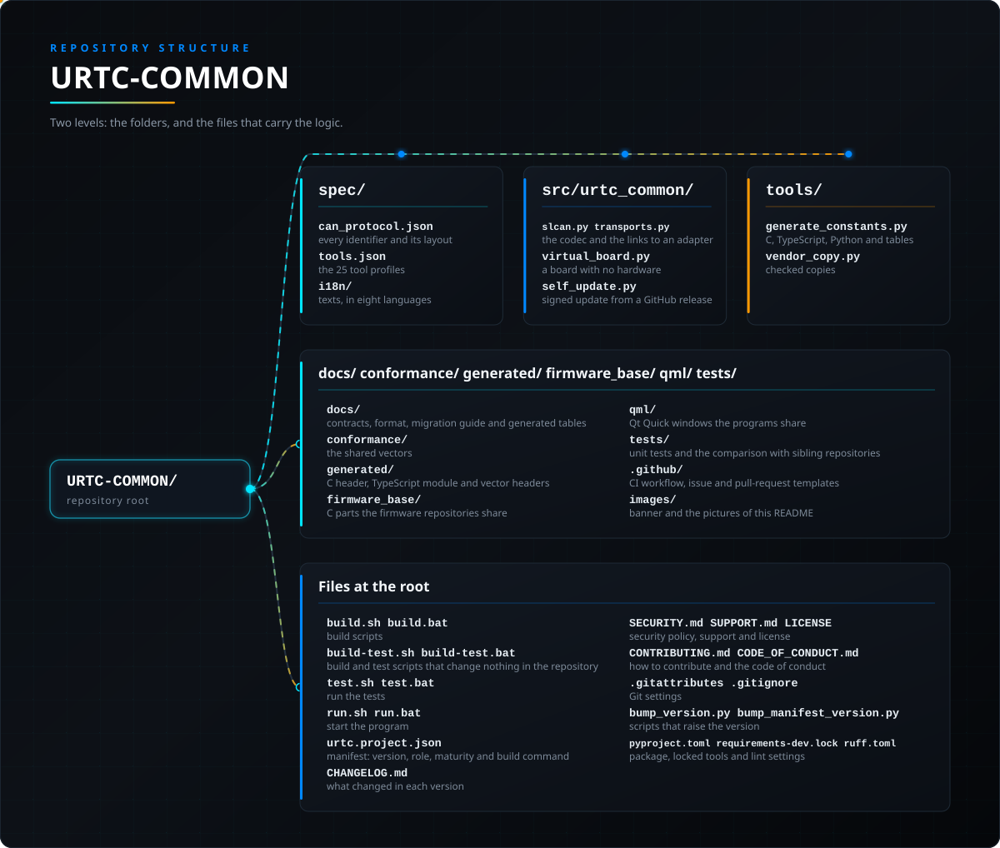

<p align="center">
  
</p>

# 🧩 URTC-COMMON

<p align="center"><a href="README.md">🇺🇸 English</a> | <a href="README_spa.md">🇪🇸 Español</a> | <a href="README_fra.md">🇫🇷 Français</a> | <a href="README_ita.md">🇮🇹 Italiano</a> | <a href="README_deu.md">🇩🇪 Deutsch</a> | 🇨🇳 <b>简体中文</b> | <a href="README_jpn.md">🇯🇵 日本語</a> | <a href="README_por.md">🇵🇹 Português</a></p>

### 作为数据的 CAN 协议：规范、生成的编解码器、一致性向量和共享传输层

<p align="center">
  
  
  
  
  
  
</p>

---

**诚实性检查 - 今天真正能运行的部分：** 本仓库包含一份规范、若干生成器、测试向量和一个小型 Python 库。所有内容都在 CI 中运行并经过测试，但目前只有 URTC-FLASHER、URTC-TESTER 和 URTC-WEB-STUDIO 在使用它（标识符、魔术载荷、硬件 ID 和共享向量，作为由锁文件保证一致的副本）；固件和传输层在各自迁移之前仍保留自己的协议副本。将规范与这些副本进行比较的测试，会在这些仓库与本仓库并排检出时读取它们的文本，否则跳过。这里的任何内容都没有在电路板或 CAN 适配器上运行过：传输层用模拟对象测试，规范则为每个标识符标明哪些实现定义了它，因此缺口是可见的，而不是被默认为已解决。

---

> **安全与安防现状:**本生态系统不是经认证的安全系统,目前也不存在已组装的 URTC 电路板。引导程序使用 CRC32 和共享密钥的 HMAC-SHA256 校验固件映像,而非非对称签名(计划中);已发布的应用映像使用公开的开发密钥签名(`signing_key_kind: dev`),因此任何人都可以生成引导程序接受的映像;尚未向任何真实电路板发送过任何内容。在依赖此处任何说法来保障人身安全之前,请先阅读[安全基线](https://github.com/JuanenRac/URTC-DOCS/blob/main/docs/SECURITY_BASELINE.md)和[威胁模型](https://github.com/JuanenRac/URTC-DOCS/blob/main/docs/THREAT_MODEL.md)。

## 📋 速览

| | |
|---|---|
| 版本 | `0.1.1` |
| 成熟度 | 雏形 |
| 测试 | 1398 |
| 技术栈 | JSON / Python |
| 真实硬件 | 仅模拟：使用模拟器、替身或仿真测试；此版本没有在真实硬件上运行的记录 |

**跳转到：** [概述](#-概述) · [架构](#-架构) · [快速开始](#-快速开始) · [测试](#-测试) · [结构](#-仓库结构) · [相关项目](#-相关项目)

<!-- urtc-section:status_common -->
## 🚦 项目状态

🟢 已完成并已验证 · 🟡 可用，但有已知限制 · 🟠 做了一半或未验证 · 🔴 未完成或不能用。从未在真实硬件上运行过的内容不会是绿色。

| 部分 | 状态 | 仓库能够证明的内容 |
| --- | :---: | --- |
| 软件 | 🟡 | 其他程序共用的代码；仅通过电脑上的测试检查。 |
| 测试 | 🟡 | 每次推送时测试套件都会在 CI 中通过。 |
| 安全 | 🟡 | 发布版使用 Ed25519 签名，并在使用前检查；密钥的处理没有他人审阅过。 |
| 文档 | 🟡 | 提供八种语言的 README 和参考文档；翻译未经母语者审阅。 |

<!-- /urtc-section:status_common -->

## 🎯 概述

工具头的 CAN 协议只写一次，以数据形式保存，并由它派生出所有内容：

* [规范](spec/can_protocol.json): 每个标识符的方向、长度规则、布局、适用工具和限制条件，魔术载荷、从机寄存器和 SLCAN 子集，以及哪些实现定义了每一项。
* [契约](docs/CONTRACTS.md): 实现必须做到的事、目前谁实现了什么，以及已知的缺口和差异。
* [规范格式](docs/SPEC_FORMAT.md): 文件的键，以及如何添加或修改标识符。
* [迁移](docs/MIGRATION.md): 各仓库采用它的顺序，以及检查如何保持副本一致。
* [协议表](docs/PROTOCOL_TABLE.md): 由规范生成的、包含全部标识符的一张表。
* [一条总线上的多个工具头](docs/MULTINODE.md): 寻址、发现和安全规则；已在 URTC 固件中实现，位于默认关闭的开关之后，仅在计算机上测试，尚未在硬件上试过。
* 界面辅助模块: `src/urtc_ui`：桌面程序可以共用的语言列表、状态徽章以及标识符、比特率和帧的格式化（不需要 Qt；URTC-FLASHER 和 URTC-TESTER 携带用 `vendor_copy.py --set ui` 生成的副本）。
* 固件部件: `firmware_base/urtc_crc8.h`，把工具架和视觉串行帧的 CRC-8 集中在一处（用 `vendor_copy.py --set firmware_base` 复制），以及 `generated/urtc_fw_vectors.h`，以 C 表格形式给出固件自身必须通过的向量（版本字段、魔术载荷、CRC-8 校验值）（`--set fw_vectors`）。
* 串行链路的帧层与速率限制器：`firmware_base/urtc_frame.h`（长度字节位于给定位置的帧的起始字节、版本、长度、完整性和 CRC-8 判定，以及反向组帧）和 `firmware_base/urtc_rate_limiter.h`（已接受消息之间的最小间隔，可跨越毫秒计数器的回绕），附 Python 参考实现（`frame_layer.py`）、速率向量，以及一个把两个头文件对照机架和视觉传感器的每个解析向量进行检验的 C 测试（用 `vendor_copy.py --set firmware_frame` 复制）
* 多个程序共用语句的术语表：`spec/i18n/glossary.json` 用八种语言把每条语句只定义一次，并列出必须这样表述的刷写器、测试器、网页工作室和更新器的键（关闭、刷新、清除、加热器 PID、端口搜索 等）；`tools/i18n_glossary.py` 检查该文件，检查与本仓库相邻的程序（大小写、重音和标点的差异可以容忍，不同的词则不行），并改写 `.lng` 和 `.json` 文件中有差异的行；夜间比对也会运行它
* 语言文件的唯一来源：`spec/i18n/catalog/<程序>.json` 以八种语言保存刷写器、测试器、Web 工作室和更新器的所有文本（术语表列出的文本是对它的引用）；`tools/i18n_generate.py sync` 为每个程序写出 `.lng`、`.json` 和 `.py` 文件，并附带锁文件（`urtc_i18n.lock.json`）和自己的测试，`check`（也在夜间比较中运行）会在文件与目录生成的内容不一致时失败。
* 程序内的快速指南与共享的 README 章节：`help_text.py`（为刷写器、测试器和更新器各写的简短步骤，八种语言）、`help_qt.py` 和 `qml/HelpDialog.qml`（帮助窗口；用 `--set help` 和 `--set help_qml` 复制），以及 `spec/readme/sections.json` 与 `tools/readme_sections.py`（各程序的项目状态以及多个 README 共用的部分，用八种语言只写一次，并用标记注释放在结构中的相应位置；`check` 在夜间比对中运行）
* 固件主机测试的断言：`firmware_base/urtc_test.h` 包含 `TEST_ASSERT`，即工具架、视觉工具和工具头固件原先各自定义了三次的宏；各仓库用 `vendor_copy.py --set firmware_test` 复制它，并保留各自声明测试套件的 `test_runner.h`。
* [一致性向量](conformance/can_vectors.json): 每个实现都必须重现的字节：每种布局、被拒绝的输入和 SLCAN 数据流。
* [工具配置](spec/tools.json)：25 个工具配置（限值、看门狗、引脚、扩展板）以数据形式保存；`generate_tools.py` 生成 TypeScript 和 Python 表格以及[工具表](docs/TOOLS_TABLE.md)。此外还有：支持导出 CSV 和 JSON 的黑匣子读取器（`blackbox.py`）、机架模拟器（`rack_sim.py`）、根据规范生成的用于板卡模糊测试的帧（`fuzz.py`），以及由 `spec/versions.json` 生成的发布[兼容性表](docs/COMPATIBILITY.md)，以及由各仓库清单生成的、说明已运行内容与尚未完成内容的[状态表](docs/STATUS.md)（`status_table.py`）。
* [刀头的自由配置](docs/FREE_TOOL.md)：机架如何处理 ID 跳线读数为 `0x1F` 的刀头：先发出查询（`0x1A3`），校验应答，再像通过跳线读取的刀头一样使用该身份；在此之前刀头保持安全状态。已在 `rack_sim.py` 中建模，并有机架固件回放的共享向量（`conformance/rack_vectors.json`）。
* [模拟总线场景](docs/BUS_SCENARIOS.md)：用 JSON 文件（`urtc-scenario/1`）描述 CAN 总线的故障：帧丢失、重复、乱序、延迟、成串丢失或被截短，节点保持沉默或拒绝命令并说明原因，以及处于自由配置、以不同方式回应 `0x1A3` 和 `0x1A2` 的刀头。`bus_scenario.py` 严格检查文件，将其应用于任何模拟传输，并根据种子生成测试场景；相同种子给出相同的帧。除非要求，否则不启用；烧录器和测试器用 `--scenario` 针对它运行各自的计划，并留下注明这是模拟的证据记录。
* **虚拟板与辅助链路：** `virtual_board.py` 在 TCP 端口上提供一块位于 SLCAN 适配器之后的板子（`python -m urtc_common.virtual_board`）；在工具要求串口的地方输入 `socket://127.0.0.1:7777`，刷写器、测试器和网关即可在没有硬件的情况下端到端运行。`sensor_frame.py` 是视觉头传感器帧的参考实现；它和机架串口帧都是版本 2，与总线一样采用大端序，并附有各自的向量（`conformance/sensor_vectors.json`、`generated/sensor_vectors.h`）。
* **从已签名的包自我更新：** `self_update.py` 是程序从 GitHub 发布版自我更新的完整流程，自身不涉及网络和窗口（下载与进度由调用方传入）：只提供平台对应包且版本严格更高的更新，只从 GitHub 发布下载所用的主机下载，用程序中固定的密钥核对公布的大小、SHA-256 以及 `urtc-pkg/1|应用|版本|平台|sha256|大小` 的 Ed25519 签名，解压时绝不离开目标文件夹（不允许 `..`、绝对路径、链接或设备），总线上有操作进行时拒绝安装，保留最近两个发布版，首次启动失败时自动回退，并记录每一步。仅用标准库；用 `vendor_copy.py --set update` 复制。
* **程序的“检查更新”菜单，可直接绘制：** `update_service.py` 包含选项（全部保守：本人不要求就不检查，`auto_check` 关闭，`require_confirmation` 开启，没有跳过校验和或签名的选项，也不能添加主机；设置与 `URTC_UPDATE_*` 环境变量，环境变量优先，某次运行降低保护时 `lowering_warnings` 会提示）、连同标识符固定的发布 Ed25519 密钥，以及 `check` / `prepare` / `install` / `rollback` 各步骤；`update_controller.py` 是窗口绘制的状态机（检查中、可用、下载中、就绪、安装中、已安装，带进度和编码错误），只有 `confirm_install` 之后才安装；`launcher.py` 启动 `current.txt` 指向的发布版，首次启动失败时退回上一个；`tools/make_update_package.py` 生成发布版可复现的 `.zip` / `.tar.gz` 及其 `.sha256` 和 `.sig`，并用固定的密钥验证。用 `vendor_copy.py --set update` 复制。
* **工具：** `generate_constants.py` 写出 C 头文件、TypeScript 模块、Python 模块和协议表（`--check` 用于比对），`make_conformance.py` 写出向量（`--check`），`vendor_copy.py` 带锁文件把部分内容复制到其他仓库并检查副本，`ci_validate.py` 是通用的仓库检查。URTC-DOCS 的 `make_glance.py` 负责写出“速览”表。
* **可安装的软件包:** 每个发布版本都附带带签名的 Python wheel(`urtc-common`,不在 PyPI 上)、带签名的源码归档以及带签名的生成 C 头文件,由 `make_release_artifacts.py`(`build`、`verify`、`reproduce`、`smoke`)以可复现的方式构建;签名就是各程序已经信任的发布密钥的签名。参见[指南](docs/PACKAGE.md)。`generate_canbus_doc.py` 根据规范写出固件仓库中 `docs/CANBUS.TXT` 的参考表(其周围的正文保持不变,`--check` 用于比较)。

- **证据记录及其历史：** `evidence.py` 写入并检查记录（`urtc-evidence/1`，[docs/EVIDENCE.md](docs/EVIDENCE.md)）；`evidence_history.py` 按最新在前列出文件夹中的记录，并逐条检查；`evidence_history_qt.py`、`qml/EvidenceHistoryDialog.qml` 和 `evidence_history_strings.py`（八种语言）是 URTC-FLASHER、URTC-TESTER 和 URTC-UPDATER 共用的历史窗口（用 `vendor_copy.py --set history_qt` 和 `--set history_qml` 复制）。

- **发布说明：** `tools/changelog_section.py VERSION [--heading] [--compat]` 输出某个版本的 CHANGELOG 小节，加上 `--compat` 时后面接 `docs/COMPATIBILITY.md` 的兼容性表；各程序带有它的副本（`vendor_copy.py --set release_notes`，表用 `--set compat`），使其发布正文具有相同的形式。

## 🧩 在 URTC 中的角色

URTC-COMMON 是工具头 CAN 协议以数据形式只写一次的地方，这样固件、URTC-FLASHER、URTC-TESTER 和 URTC-WEB-STUDIO 就不必再各自维护同一份文字的四种解读。它包含规范、由规范生成的内容、每个实现都必须重现的向量，以及两个 Python 工具共用的传输层。它本身不会改变其中任何一个的行为：各仓库逐步采用它（参见 docs/MIGRATION.md）。

## 🏛️ 架构

<p align="center">
  
</p>

本仓库各部分如何协作：谁在使用它、它包含什么、它依赖什么。图片由 `docs/architecture.json` 绘制，并与代码核对。

## 🚀 快速开始

**要求：** Python 3.10 或更高版本；测试需要 pytest 和 jsonschema；用生成的 TypeScript 运行向量需要 Node 22.18 或更高版本（可选）

```bash
python tools/generate_constants.py --check           # C、TypeScript 和 Python 文件以及协议表都是最新的
python tools/make_conformance.py --check             # 向量是最新的
python -m urtc_common.cli conformance                # 本包重现每一个向量
python tools/vendor_copy.py check TARGET --source .  # 其他仓库中的副本没有被手工修改，也没有落后
python -m pytest tests -q                            # 单元测试以及与相邻仓库的比较
python -m mypy                                       # urtc_common 和 urtc_ui 的类型检查
```

## 🧪 测试

测试套件共有 1398 个测试（`python -m pytest tests -q`）。它们检查：规范是否符合其模式；生成的 C、TypeScript 和 Python 文件是否与生成器写出的一致；用 Python、用 Node 运行的 TypeScript 和用主机编译器编译的 C 来核对一致性向量；SLCAN 编解码器和使用模拟对象的传输层；虚拟板；经过签名的自更新流程；以及与放在本仓库旁边的各仓库的比较。缺少可选工具（Node、C 编译器、PySide6）或相邻仓库时，部分测试会被跳过。`python -m mypy` 检查软件包的类型。

## 🏗️ 构建与发布

`build.sh` / `build.bat` 安装软件包并运行测试；`build-test.sh` / `build-test.bat` 只检查，不改变任何版本；`run.sh` / `run.bat` 启动命令行（`conformance`、`describe`、`decode`、`slcan`）。每个发布版都附带经过签名的 Python wheel（`urtc-common`，不在 PyPI 上）、签名的源码压缩包和签名的生成 C 头文件，由 `tools/make_release_artifacts.py`（`build`、`verify`、`reproduce`、`smoke`）可复现地构建；参见[软件包指南](docs/PACKAGE.md)。

## 📂 仓库结构

<p align="center">
  
</p>

<details>
<summary>目录树的文本版</summary>

```text
URTC-COMMON/
├── spec/                                            规范、工具配置、版本数据和文本目录
├── src/urtc_common/                                 Python 包：协议、SLCAN、传输、虚拟板、自更新
├── tools/                                           带 --check 的生成器、vendor_copy.py 以及共用的 CI 检查
├── docs/                                            合约、格式、迁移指南和生成的表格
├── conformance/                                     共用向量
├── generated/                                       C 头文件、TypeScript 模块和向量头文件
├── firmware_base/                                   固件仓库共用的 C 代码
├── qml/                                             各程序共用的 Qt Quick 窗口
├── tests/                                           单元测试及与相邻仓库的比较
├── .github/                                         CI 工作流以及 Issue 和 Pull Request 模板
├── images/                                          横幅和本 README 的图片
├── build.sh build.bat                               构建脚本
├── build-test.sh build-test.bat                     构建并测试的脚本，不会修改仓库内容
├── test.sh test.bat                                 运行测试
├── run.sh run.bat                                   启动程序
├── urtc.project.json                                清单：版本、角色、成熟度和构建命令
├── CHANGELOG.md                                     每个版本的变更
├── SECURITY.md SUPPORT.md LICENSE                   安全政策、支持和许可证
├── NOTICE                                           所含第三方部分的许可证
├── CONTRIBUTING.md CODE_OF_CONDUCT.md               如何参与贡献和行为准则
├── .gitattributes .gitignore                        Git 设置
├── bump_version.py bump_manifest_version.py         提升版本号的脚本
└── pyproject.toml requirements-dev.lock ruff.toml   软件包、锁定的工具和 lint 设置
```

</details>

## 🗺️ 路线图与已知限制

**目前已知的限制**

* 这里的一切都没有在真实的板子或 CAN 适配器上运行过：传输层用模拟对象测试，规范会为每个标识符说明由哪些实现定义，因此缺口一目了然。
* 固件和传输层在各自迁移之前仍保留自己的协议副本；目前只有 URTC-FLASHER、URTC-TESTER 和 URTC-WEB-STUDIO 使用本仓库。
* 把规范与其他仓库比较的测试，在那些仓库被检出到本仓库旁边时读取其文本，否则跳过。

**下一步**

* 让每个仓库逐步迁移到规范上（[迁移指南](docs/MIGRATION.md)）。

## 🌍 语言

README 和文本提供英语、西班牙语、法语、意大利语、德语、汉语、日语和欧洲葡萄牙语版本。

## 🔗 相关项目

URTC 由相互独立的仓库组成，每个仓库都有自己的版本、测试和 README。以下是按组划分的家族：

* **URTC Tool Platform:**
  * [URTC](https://github.com/JuanenRac/URTC) - 工具头电路板的固件(25 个工具配置、CAN 引导程序)以及 CAN 协议参考。
  * **URTC-COMMON** (本仓库) - 只写一次的 CAN 协议数据(规范、生成的表格、一致性向量)以及各程序共享的代码。
  * [URTC-FLASHER](https://github.com/JuanenRac/URTC-FLASHER) - 通过 CAN 或 SWD/JTAG 更新电路板固件的桌面工具。
  * [URTC-GATEWAY](https://github.com/JuanenRac/URTC-GATEWAY) - 位于 CAN 总线前的网关:只放行列表中的标识符,限制其速率,并要求会话密钥。
  * [URTC-SMART-RACK](https://github.com/JuanenRac/URTC-SMART-RACK) - 用于带预热和生命周期跟踪的工具架的、与硬件无关的 C 逻辑和命令协议。
  * [URTC-TESTER](https://github.com/JuanenRac/URTC-TESTER) - 桌面实时 CAN 总线测试器,显示电路板所报告工具配置的控件和遥测。
  * [URTC-VISION-TOOL](https://github.com/JuanenRac/URTC-VISION-TOOL) - C 语言的传感器帧协议,以及用于检测工具头的 Python 热成像/RGB 配套程序。
  * [URTC-WEB-STUDIO](https://github.com/JuanenRac/URTC-WEB-STUDIO) - 通过 Web Serial 和 SLCAN 烧录并测试电路板的浏览器应用,无需安装。
* **Ecosystem Operations:**
  * [URTC-DEVTOOLS](https://github.com/JuanenRac/URTC-DEVTOOLS) - 家族共用的仓库工具，作为带版本的整套工具，并用锁文件区分被改动的副本和已过时的副本。
  * [URTC-DOCS](https://github.com/JuanenRac/URTC-DOCS) - 生态系统的架构、接口、安全基线和生成的目录,以及比较所有仓库的工具。
  * [URTC-UPDATER](https://github.com/JuanenRac/URTC-UPDATER) - 检测、安装并更新 URTC 家族仓库的桌面工具,每次只执行一个明确的操作。

**姊妹项目（相互独立，共用同一基础和工具）：**

* **[HYDRA-UMC-DOCS](https://github.com/JuanenRac/HYDRA-UMC-DOCS)** - 姊妹项目：HYDRA-UMC 的文档中心，一个独立的生态，与本生态共用基础和工具
* **[ARMOR-DOCS](https://github.com/JuanenRac/ARMOR-DOCS)** - 姊妹项目：A.R.M.O.R. 安全生态的文档中心，同样独立，建立在同一基础上
* **[JuanenRac](https://github.com/JuanenRac/JuanenRac)** - 所有生态的个人主页和状态面板

## 📚 文档

更多阅读：

* [契约：每个实现必须做到的事和已知缺口](docs/CONTRACTS.md)
* [规范格式及修改方法](docs/SPEC_FORMAT.md)
* [迁移：各仓库如何采用](docs/MIGRATION.md)
* [协议表：每个标识符及其实现者](docs/PROTOCOL_TABLE.md)
* [一条总线上的多个工具头](docs/MULTINODE.md)
* [本仓库的变更日志](CHANGELOG.md)
* [许可证（GPL-3.0-or-later）](LICENSE)
* 问题、想法和报告：electrohobby3d@gmail.com

## 🤝 参与贡献与社区

* 提交 Pull Request 之前请运行 `URTC_CI=1 python tools/ci_validate.py`：必须通过。参见 [CONTRIBUTING.md](CONTRIBUTING.md) 和[行为准则](CODE_OF_CONDUCT.md)。
* README 有八种语言：修改文字时要同步修改全部八个文件，与其他仓库共用的章节由 URTC-COMMON 的 `tools/readme_sections.py` 写入。
* 不要把仅仅构建过的东西描述为已在板子上运行。
* 请私下报告漏洞：[SECURITY.md](SECURITY.md)。问题、想法和报告：electrohobby3d@gmail.com（[SUPPORT.md](SUPPORT.md)）。

## 👤 作者

**JuanenRac (Electro Hobby 3D)** · electrohobby3d@gmail.com

## 📜 许可证

GPL-3.0-or-later - 参见 [LICENSE](LICENSE)。
